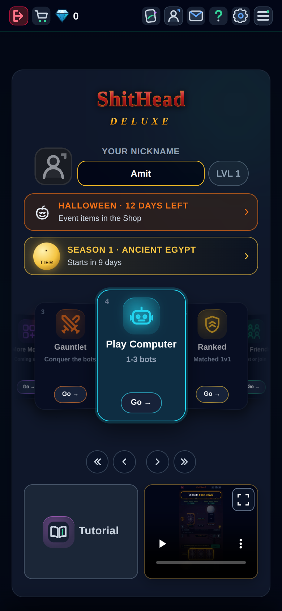
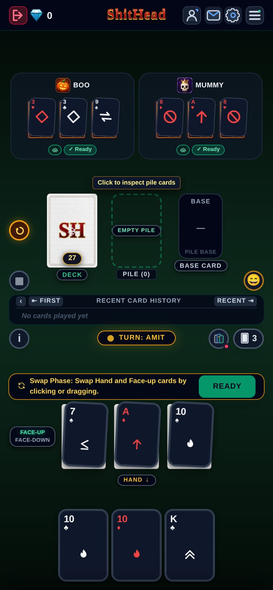
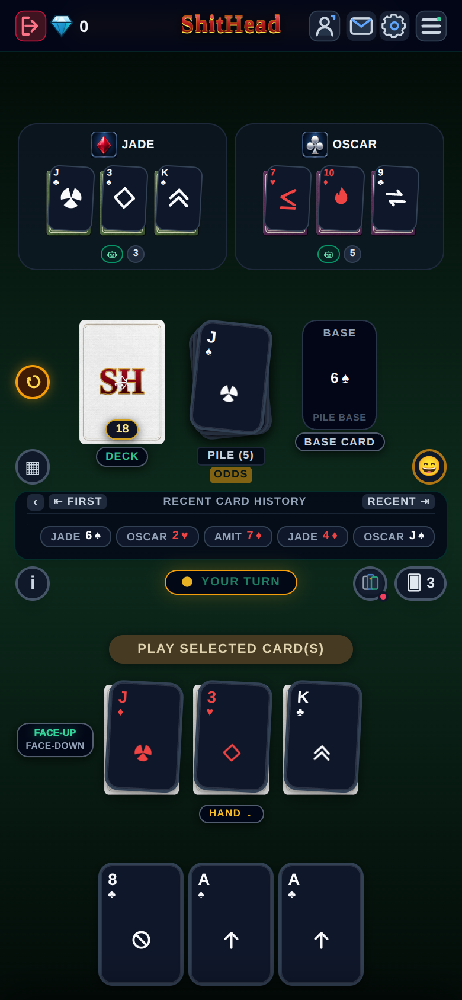
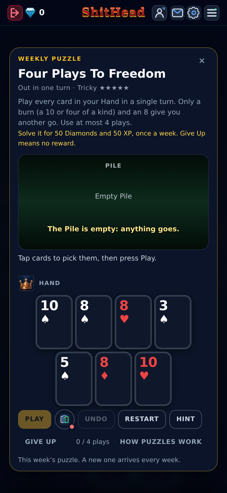
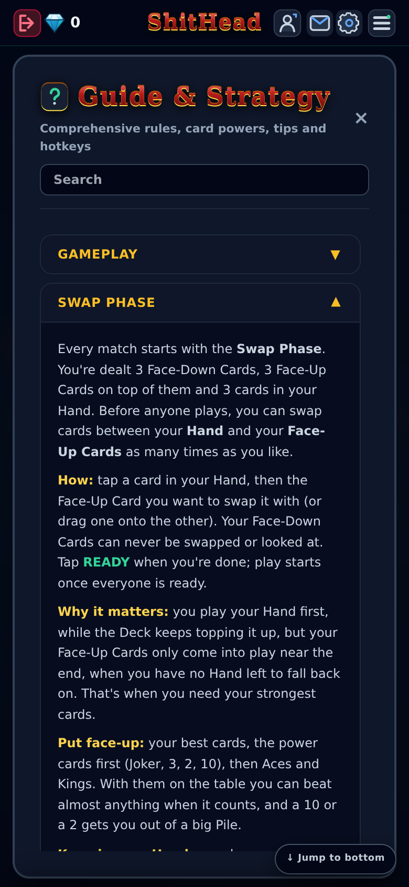
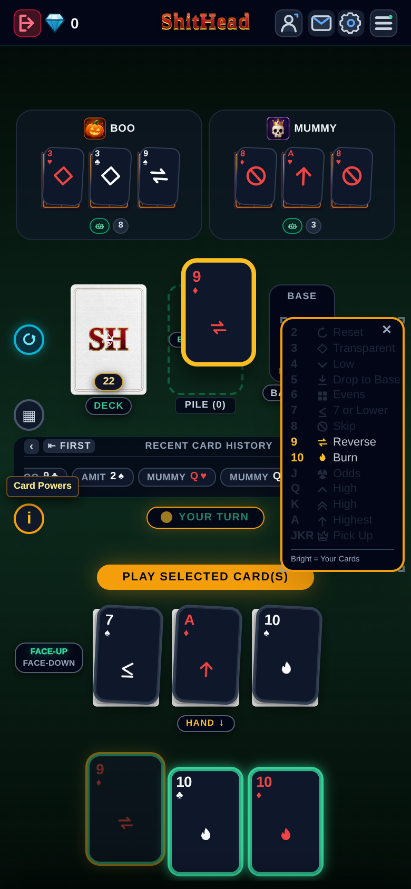
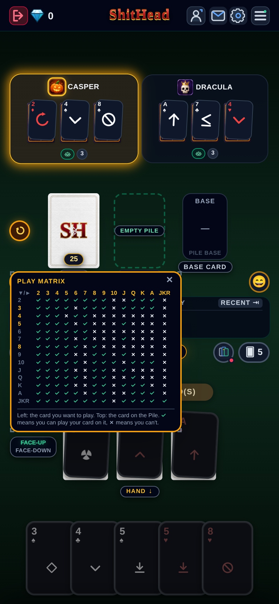

<!-- README-VERSION: v400 — refresh text + screenshots every 20 versions from v180 (v180, v200, v220…); see CLAUDE.md -->
# 💩 ShitHead Deluxe

**The classic card game ShitHead, rebuilt for your phone.** Play against bots, play friends in private rooms, or climb the Ranked ladder. Get rid of all your cards. The last player holding cards is the ShitHead.

### ▶ [Play now at shithead-deluxe.web.app](https://shithead-deluxe.web.app/)

Free, no download needed. It runs in any modern browser on phones, foldables, tablets and computers, installs like an app (Add to Home Screen / Install App), and Play Computer even works offline.

  
  
  
  
  

---

## How to play

Everyone is dealt **3 Face-Down cards**, **3 Face-Up cards** on top of them, and **3 cards in their Hand**. The rest form the Deck.

1. **Swap Phase.** Before anyone plays, swap cards between your Hand and your Face-Up cards. Your Face-Up cards are played near the end, when you have no Hand to fall back on, so put your best cards there (Jokers, 3s, 2s, 10s, Aces) and keep low cards in your Hand. Tap **READY** when you're done.
2. **Hand.** Play a card **equal to or higher** than the top of the Pile. After your turn you top back up to 3 from the Deck while it lasts. Can't play? You pick up the whole Pile.
3. **Face-Up.** When your Hand and the Deck are both empty, play your Face-Up cards.
4. **Face-Down.** Last, flip your Face-Down cards blind, one at a time. If the card you flip can't be played, you pick up the Pile.

Four of the same rank in a row **burns** the Pile. So does a 10. Whoever burns plays again, unless that was their last card: then they finish and the next player carries on.

## Card powers

  
  

Tap the **ⓘ** button during a game for every card's power, and the **▦ Play Matrix** to see which card can go on which: find your card down the left and the Pile's card along the top, and a tick means it plays. **Press and hold any card** (in your hand, on the table or on the Pile) to read what it does and whether you can play it right now. When a 3 is on top, the Pile label shows what you really have to beat (for example *Transparent - Q*), and the card history circle shows the card to beat at a glance.

| Card | Power |
|---|---|
| **2** ⭐ Reset | Plays on anything except a Jack, and resets the Pile so anything can follow. |
| **3** ⭐ Transparent | Plays on anything except a 6. It's see-through: the next player must beat the card underneath it. |
| **4** Low | The most restrictive card: only goes on a 2, 3, 4, 6 or 7. |
| **5** Drop to Base | The next player must beat the card at the very bottom of the Pile. |
| **6** Evens | The next player must play an even card (2, 4, 6, 8, 10, Q, A or Joker). |
| **7** 7 or Lower | The next player must play a 7 or lower (or a Joker). |
| **8** Skip | Skips the next player; several 8s skip that many. |
| **9** Reverse | An odd number of 9s reverses the direction of play. |
| **10** ⭐ Burn | Burns the whole Pile, and you play again. |
| **J** Odds | The next player must play an odd card (3, 5, 7, 9, J, K or Joker). |
| **Q / K** | Standard high cards. |
| **A** ⭐ | The highest standard card. |
| **Joker** ⭐ Duel | Plays on anything and forces an opponent of your choice to pick up the Pile. If they hold a Joker they can deflect it straight back! |

Card strength, weakest to strongest: **4, 5, 6, 7, 8, 9, J, Q, K, A, 10, 2, 3, Joker.**

## Features

- **A home screen built around the modes**: swipe a 3D carousel of cards (or use the arrows, the mouse wheel or keys 1-7): Play Computer, the Gauntlet, Ranked, Play Friends and More Modes. Tap the middle card and it flips over and spreads across the screen into that mode's page; the game remembers the last mode you opened. More Modes holds the weekly Puzzles, 2 vs 2 teams and previews of Randomiser, Multiple Decks and No Mercy. Each of the two outer Shortcut cards can pin one mode (never the same one twice).
- **2 vs 2 teams**: play with a partner opposite you against bots or friends, choose bot difficulty and earn the Dream Team avatar with 10 wins.
- **Free Season Pass**: two-month seasons with 50 tiers, Diamonds and themed card backs, avatars, tables and a burn at tier 40. Season XP follows your regular XP rewards; tier rewards arrive automatically. Six themes run from Ancient Egypt and Ice Age through Feudal Japan, Deep Ocean, Greek Mythology and Dark Sorcery.
- **Double-Tap To Play**: enable it in Settings → Gameplay to play a staged card with a second tap. Ranked swaps show your changes immediately while the server confirms them.
- **Watch friends**: friends can watch a Play Computer or Gauntlet game when Friends Can Watch is enabled; hidden cards remain hidden.
- **One header everywhere**: Exit on the far left (it asks first, in the game's own style), your Diamonds, then Shop, Custom, Profile, Inbox, Guide, Settings and the menu. In a game the extras fold into the menu and the ShitHead logo takes you home.
- **A short tour for new players**: the first time a new account signs in, a six-step tour shows the header, the game modes and the Tutorial button (skip it any time, replay it from Menu → Take The Tour). Press and hold a mode card to pick it up and put the cards in your own order.
- **Opens fast**: a loading screen paints at once, your level and Diamonds show straight away, and the installed Android app flows from its icon into the game.
- **XP & levels 1–99**: every game, win, Ranked game, Gauntlet bot and challenge earns XP (a win 75, a Ranked win 150, the first game of the day +50). Levels follow a RuneScape-style curve (level 92 is half-way to 99) and pay Diamonds: 20 a level, 100 on every 10th. A thin XP bar along the bottom of the header shows your progress (hover or tap it for the numbers), and your level shows on the table, on every leaderboard, on your Profile and in your friends list. Games you played before levels existed counted too. Levels unlock earn-only avatars, card backs and burn effects, faster game speeds, extra saved looks, Best of series and the harder Gauntlets.
- **Level Ladder**: tap your level anywhere to open a timeline of every level and what it unlocks, scrolled to "You are here". A level up climbs the ladder to show what you just won (equip it in one tap), your friends sit at their own levels (tap +N to see everyone on a crowded level), and a gold dot on your level means there's something new you haven't looked at yet.
- **Best of 3 / 5 / 7 series** between two friends (both players need level 20 / 35 / 45): each pays an entry (30, 50 or 70 Diamonds), the server matches the pot and the winner takes 4x. Both players press Ready before the next game starts, the score sits on the table, and if someone drops out a bot plays their seat until they're back (or, after 5 of its turns, the series goes to the player still there).

- **Weekly Puzzles** (More Modes → Puzzles, or pin it to a shortcut): a set table and one way to win, drawn with your own cards, table, deck and effects. 52 puzzles in eight kinds: play your whole Hand in one turn, burn the Pile, leave the Rival nothing to play, clear your three Face-Up cards, flip your three Face-Down cards (they stay face down: you remember them), play your Joker to hand the Rival a big Pile, finish on a chosen card, and longer two- and three-turn puzzles where the Rival answers between your turns. One puzzle a week for everyone (a shuffled order that never repeats a kind two weeks running, and plays every puzzle before any returns); solve it signed in for 50 Diamonds and 50 XP, checked by the server. Undo, Restart, a Hint that follows where you are in the puzzle, and Give Up.
- **Seasonal events that are worth logging in for** (Halloween, Christmas, Diwali, Lunar New Year and more): a pop-up lists everything the event sells (with a Preview button on each item) and what you can earn, a chip on the home screen counts the days left, and bots at the table wear the event's names and cosmetics. Win games for the event's earn-only avatar, finish the four event challenges for the Champion frame, climb the **event leaderboard** (the top 10 with 5+ wins win up to 1000 Diamonds when it ends) and collect a **login bonus** of extra Diamonds on every day the event is live. 1.5x XP all event long, a reminder in the last three days, and a recap in your Inbox when it's over.
- **Shop wishlist**: heart any item to add it to your wishlist (Profile → Wishlist, or the Wishlist filter in the Shop). Friends see your list and can gift an item straight from it, and you get an Inbox reminder when something you want is in a live event.
- **Play Computer** with four difficulties (Easy → Boss) that unlock as you win, playable offline. Close the app mid-game and it picks up exactly where you left off.
- **The Gauntlet**: Easy, Hard and Boss runs. Easy: beat 5 bots in a row (Easy, Easy, Medium, Hard, Boss) with 3 lives. Hard (2 lives) and Boss (1 life) unlock with levels. The first clear of each wins an exclusive animated avatar and frame, then Diamonds every day you beat it again.
- **Play Friends**: host or join with a room code, pick a mode from a card carousel, and sit four avatar seats round a compact lobby. House Rules (Classic plus three named slots saved to your account) give custom card powers. Share an invite link, react with emotes, and a Medium bot keeps your seat if your signal drops: reopen the game and you go straight back in. After 5 bot turns you're out of that game, and the rest play on. Friends can watch your match live.
- **Ranked** 1v1 matchmaking with an Elo rating and tiers from Novice to Master, plus 10 points for a win and bonuses at win-streak milestones. The server shuffles and holds hidden cards, validates every move before accepting it and scores its own final record. Opponent hands, blind values and stock order stay out of browser data.
- **Easier to read, easier to play**: a 3 on the Pile now shows the card it covers tucked underneath, however many 3s are stacked. Select All Of A Rank has a Protect Best Cards option (Settings → Gameplay) so one tap picks a single 2, 3, 10 or Ace instead of wasting them.
- **Stalemate draws**: a game where the same cards keep going round without progress ends in a draw, shown in Ranked stats and Match History.
- **Tutorial**: a one-minute Quick Start (including press-and-hold card info) plus in-depth lessons for every card, and a searchable Guide (rules, card powers, the Gauntlet, key terms).
- **Challenges and Diamonds**: 3 daily and 5 weekly challenges (18 weekly ones in rotation, from Blind Luck and Triple Trouble to Streaker, Pile Diver and Daily Grinder), the Daily Gauntlet, a login streak and milestones. During every seasonal event a Seasonal tab adds four big event-long challenges and a Season Complete bonus. Tap your completed count to see every challenge you've finished.
- **Burn effects that use your real card**: Origami Fold folds the top card into a long-necked swan that flies away, Stupendous Confectionery bursts it open into dozens of tumbling sweets, Lava Melt sinks it into bubbling lava and Coloured Flame burns it from the bottom up in violet, pink and blue fire, each piece moving on its own and every one with its own sound.
- **The ShitStorm**: the complete curled mascot head sits above a shaded spinning funnel that pulls in the real pile card and collapses into embers, with a matching two-second sound.
- **Painted burn effects**: the Default Burn and the levelling-up burns (Spark Snap, Smoke Burst, Inferno Sweep, Hellfire Spiral, Royal Incineration and The ShitStorm) and Ghost Flames are hand-painted artwork brought to life in 3D: layered fire and smoke, light beams, sparks and charred fragments flying in depth, and the real card on top of the Pile curling, burning and breaking apart. Any card piece that flips over shows the burning player's own card back, and every burn has its own sound.
- **Shop and Custom** (each opens on an All tab with every item in folding sections): tables, card backs, frames, burn effects with their own sounds, **Joker effects** (a short animation over the table whenever you play a Joker: Jester's Grin, Jack-in-the-Box, Magic Trick, Glitch and more, plus a Pumpkin Joker, Santa Joker and others for each seasonal event), victory effects, emote packs and avatars, plus seasonal events (Halloween, Christmas, Diwali, Lunar New Year and more). Premium items too: animated avatars (Royal Flush, Cosmic Ace, and the 5000 ones: Sapphire Sovereign roars, Crimson Inferno chuckles, Scarlet Guardian flaps and Turtley snaps, animated at every size), vector tables (Neon City, Northern Lights, Deep Space), cinematic burns, Joker and victory effects, and card backs like Dragon Scale and Stained Glass. **Decks** change the card faces (Lavender, Paper Classic, Blueprint, Chalkboard, Frosted Glass, Neon Night, Royal Gold and more). Earn-only avatars, card backs, burns and frames for Ranked tiers, the Gauntlet, levelling up and recruiting friends. All art is vector or high-resolution, so it stays sharp on 4K screens. Every table is a full scene that fills any screen shape. Free tables and card backs (Oak Wood, Classic Felt, Cobalt, Sage and Plum Linen), Custom filters (Owned / Not Owned / Equipped), press and hold any item for a big preview, up to 3 saved looks you can switch in one tap, and a **Collection** page showing everything you own and how to get the rest.
- **Friends**: friend requests, gifts, game invites and a public showcase of your look (deck included), with push notifications and an online status that only shows while the game is actually open. Invite friends with your own link and you both earn Diamonds once they've played a few games.
- **Leaderboards** (the tabs scroll sideways): Ranked rating, challenges completed, Gauntlet bots beaten, Levels and, during an event, its own Event board, with All-time / This week filters for Challenges, Gauntlet and Levels, with everyone's level, with an Inbox message when you reach the top 10, #3, #2 or #1. Tap anyone to open their profile, add them as a friend or ignore them.
- **Match summary** with stats, XP and a shareable result card, plus a full match history. Every mode ends with the same buttons: Match Stats and the obvious next step (Quick Play, Continue, Return To Ranked, Ready For Next Game).
- **Built for every screen**: the hand resizes to fill your screen (including the installed iPhone app, edge to edge), overlapped cards stay easy to tap, the table grows on tablets and computers, foldables are supported (a small cover screen asks you to open the phone), and a phone turned sideways asks to be turned upright. Settings (Hand Sort, Turn Alert, Card History, Show Others' Effects and more) follow your account across devices, and an accessibility **Big Print** deck gives large, high-contrast ranks that stay readable in any hand.
- **Always up to date**: when a new version is out, the game offers to update itself, and a game in progress carries on afterwards.
- **Your data**: download everything stored about your account, or delete it (with 7 days to change your mind).

## Tech

- The game is plain JavaScript with no build step: [`index.html`](index.html) holds the markup, and the code lives in script files beside it (`app.js`, `shop.js`, `home-navigation.js`, `tutorial.js`, `js/`…). See [`CLAUDE.md`](CLAUDE.md) for the layout.
- It's hosted on **Firebase Hosting**, and every push to `main` deploys automatically.
- **Firebase Realtime Database** handles online rooms, profiles and friends.
- **Firebase Auth** handles sign-in (Google or email).
- **Cloud Functions** ([`functions/`](functions)) handle the economy: Diamonds, XP, purchases, gifts, referrals and rewards are saved on the server. Ranked uses server-held cards and validated moves. Casual rooms and some solo/Gauntlet/challenge reports still need stronger verification; see the [security audit](docs/SECURITY-AUDIT-2026-09-30.md). Functions also maintain leaderboards and send push notifications.
- A service worker makes the game installable and lets Play Computer games run offline.
- Painted burns are drawn with WebGL ([`art/burns/level-3d/burns3d.js`](art/burns/level-3d/burns3d.js)) from layers cut out of the artwork by [`tools/make-burn-layers.py`](tools/make-burn-layers.py).
- The puzzle rules and solver ([`js/puzzle-engine.js`](js/puzzle-engine.js), copied to `functions/` for the server's check) are shared by the page, the tests and the search tools ([`tools/puzzle-search.js`](tools/puzzle-search.js), [`tools/puzzle-search-zones.js`](tools/puzzle-search-zones.js)).
- A developer test suite runs in the browser: open `index.html?dev-tests=1`. Node tests live in `tools/*-test.js`.
